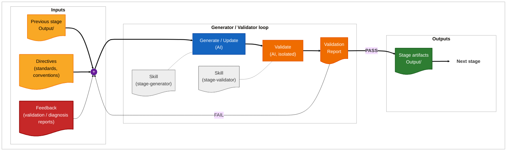
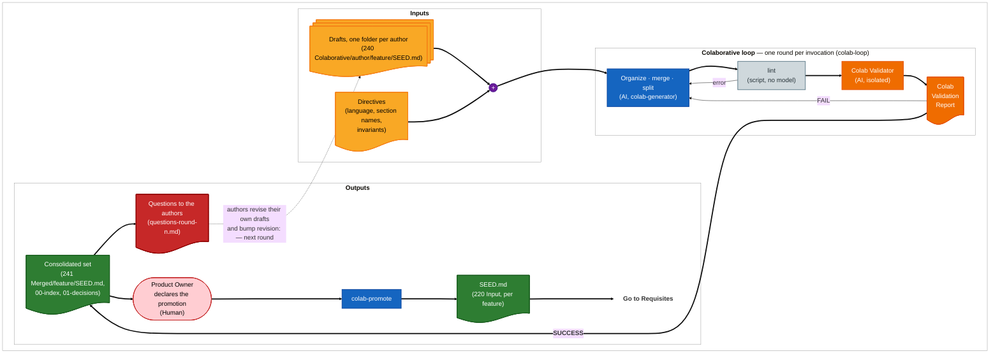
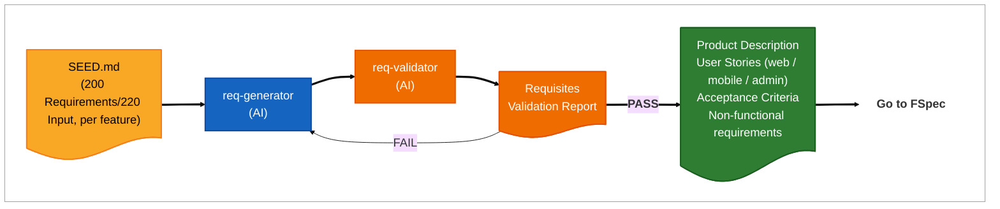
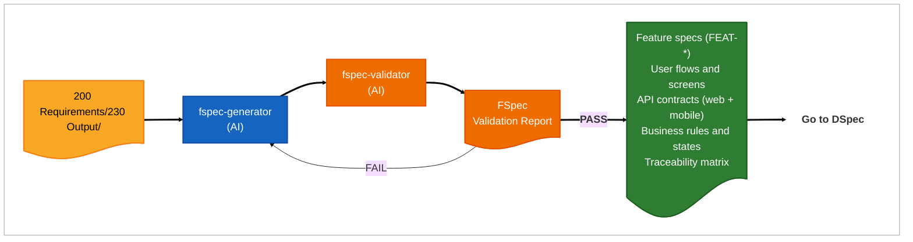
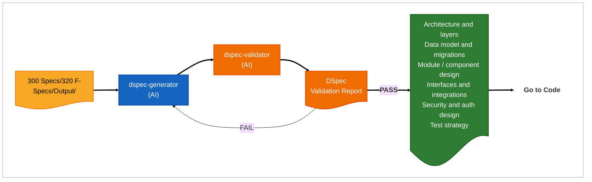
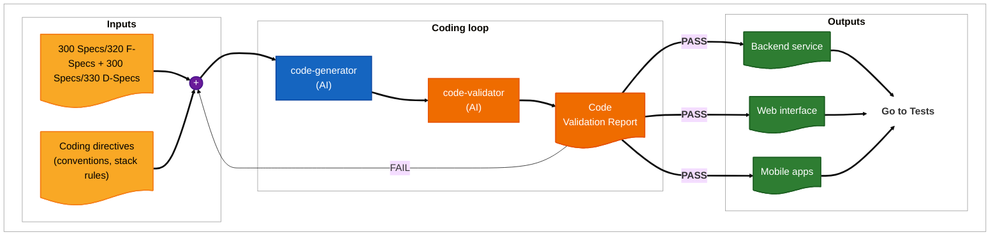
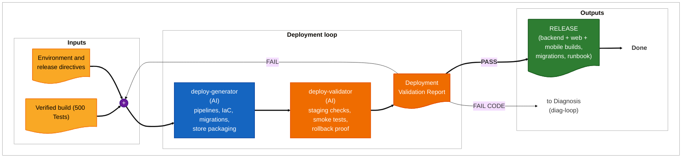
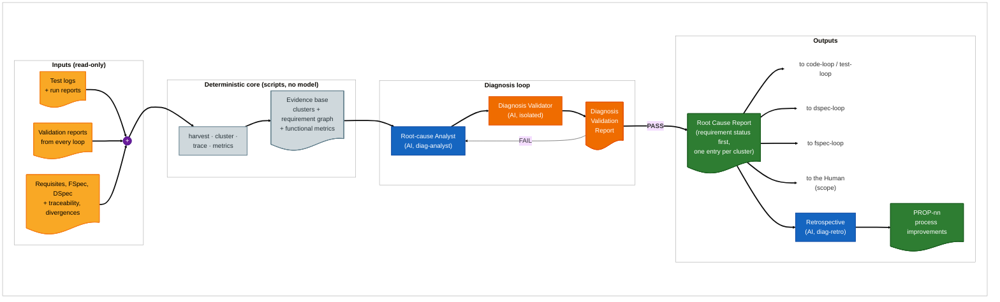

# Software Development with AI

## Scope

This document defines the AI-assisted development process for a system composed of a **backend service**, a **web interface** and **mobile apps** that communicate with it.

The process is a chain of **loops**, one per project folder. Every loop has the same shape: a **generator** produces artifacts, a **validator** judges them against the artifacts of the previous stage, and a **validation report** decides whether the chain moves forward or the stage repeats.

| # | Folder | Loop | Produces |
|---|---|---|---|
| 1 | `200 Requirements` | `req-loop` | Product description, user stories, acceptance criteria |
| 2 | `300 Specs/320 F-Specs` | `fspec-loop` | Functional specification (behavior, flows, API contracts, UX) |
| 3 | `300 Specs/330 D-Specs` | `dspec-loop` | Design specification (architecture, data model, modules, interfaces) |
| 4 | `400 Code` | `code-loop` | Backend, web interface and mobile app implementation |
| 5 | `500 Tests` | `test-loop` | Test suites and their execution reports |
| 6 | `600 Deploy` | `deploy-loop` | Build, release, environment and rollout artifacts |
| — | — | `diag-loop` | Root-cause reports when a loop fails |

Each stage reads its input root (fed by the previous stage's output root) and writes only into its own output root. **The roots are not uniform** — read them from this table, never by pattern:

| Stage | Input root | Output root |
|---|---|---|
| Requirements | `200 Requirements/220 Input` | `200 Requirements/230 Output` |
| F-Spec | `300 Specs/320 F-Specs/Input` | `300 Specs/320 F-Specs/Output` |
| D-Spec | `300 Specs/330 D-Specs/Input` | `300 Specs/330 D-Specs/Output` |
| Code | `400 Code/Input` | `400 Code/Output` |
| Tests | `500 Tests/Input` | `500 Tests/Output` |
| Deploy | `600 Deploy/Input` | `600 Deploy/Output` |

Three folders sit outside the loops and are worth naming, because each is a place a loop must **not** write:

- **`400 Code/Source/`** — the code root. The implementation and test loops write the source itself here (`app/`, `static/`, `migrations/`, `tests/`, the mobile app tree); `400 Code/Output/<feature>/` holds only that stage's manifest, traceability and reports.
- **`200 Requirements/240 Colaborative/<author>/<feature>/`** — collaborative drafts. A seed is authored here and **promoted** to `200 Requirements/220 Input/<feature>/` under the same feature when it is ready to enter the pipeline. No automated process edits a draft. Promotion is gated: **nothing is promoted until every collaborator has posted their drafts, and integration is an announced step — never automatic.** It happens because a Product Owner says it should, not because a condition was met; no skill and no loop ever promotes a seed. The set is then read together, deduplicated and promoted at once — see the integration gate in `200 Requirements/220 Input/README.md`. Before that is said, the pipeline has no feature and no loop runs, which is the intended state, not a stall.
- **`300 Specs/__old__Specs/`** — a dead archive of the reverse-engineered specs of the running system. No loop reads or writes it.

## The entry point

Nothing enters the chain without a **seed**: one folder per unit of work under `200 Requirements/220 Input/`, holding a `SEED.md`.

| | |
|---|---|
| **Feature** | The folder name — a filesystem-safe lowercase name (`posop-timeline`, `prms-branching`). The same feature names every stage's output folder, character for character |
| **Seed** | `200 Requirements/220 Input/<feature>/SEED.md` — what must be true and for whom, never how to build it |
| **Authored by** | A human — directly, or through the collaborative round of section 0, where several authors' drafts are consolidated and the result is promoted by a declared human step. No loop ever writes a seed |
| **Versioned by** | `revision:` in its front matter, bumped by the author on every substantive change |
| **Beside it** | `DOMAIN.md` — the durable domain facts and decisions of this feature, read by every stage and written by no loop — and `SCOPE-BACKLOG.md`, where the loops hand back the surface a fix round was not allowed to add |

The seed is the only argument every loop takes: `req-loop <feature>`, `code-loop <feature>`, and so on. Every validation report stamps the seed revision it judged against, so a spec set whose seed has moved on underneath it is detected rather than assumed current.

All skills used by these loops live under `root/.claude/`. This document describes **what each loop does**, not how its skills are written.

---

## General Process

```mermaid
%%{init: {'theme': 'base', 'themeVariables': {'fontSize': '12px'}}}%%
flowchart LR
    subgraph DRAW[" "]
    direction LR
        START@{shape: doc, label: "SEED.md"}
        REQ["Requisites\n(req-loop)"]
        R@{shape: doc, label: "200 Requirements"}
        FSPEC["Functional Spec\n(fspec-loop)"]
        F@{shape: doc, label: "300 Specs/320 F-Specs"}
        DSPEC["Design Spec\n(dspec-loop)"]
        D@{shape: doc, label: "300 Specs/330 D-Specs"}
        CODE["Implementation\n(code-loop)"]
        C@{shape: doc, label: "400 Code"}
        TEST["Testing\n(test-loop)"]
        T@{shape: doc, label: "500 Tests"}
        DEP["Deployment\n(deploy-loop)"]
        OUT@{shape: doc, label: "600 Deploy\nRELEASE"}

        START --> REQ -->|"PASS"| R --> FSPEC -->|"PASS"| F --> DSPEC -->|"PASS"| D --> CODE -->|"PASS"| C --> TEST -->|"PASS"| T --> DEP -->|"PASS"| OUT

        DIAG["Diagnosis\n(diag-loop)"]
        PERS1@{shape: stadium, label: "Review\n(Human)"}
        PROP@{shape: doc, label: "PROP-nn\nprocess improvements"}

        CODE -->|"FAIL"| DIAG
        TEST -->|"FAIL"| DIAG
        DEP -->|"FAIL"| DIAG

        DIAG -->|"CODE / TEST"| CODE
        DIAG -->|"DESIGN"| DSPEC
        DIAG -->|"FUNCTIONAL"| FSPEC
        DIAG -->|"SCOPE"| PERS1 -->|"Update requisites"| REQ
        DIAG -.->|"recurring classes"| PROP
    end

    classDef terminal fill:#2e7d32,color:#fff,stroke:#1b5e20,stroke-width:2px;
    classDef process fill:#1565c0,color:#fff,stroke:#0d47a1,stroke-width:2px;
    classDef input fill:#f9a825,color:#000,stroke:#f57f17,stroke-width:2px;
    classDef diagnose fill:#00838f,color:#fff,stroke:#004d54,stroke-width:2px;
    classDef review fill:#ffcdd2,color:#000,stroke:#c62828,stroke-width:2px;
    classDef report fill:#c62828,color:#fff,stroke:#8e0000,stroke-width:2px;
    classDef block fill:#FFF,stroke:#999;

    class REQ,FSPEC,DSPEC,CODE,TEST,DEP process;
    class DIAG diagnose;
    class R,F,D,C,T,OUT terminal;
    class START input;
    class PERS1 review;
    class PROP report;
    class DRAW block;
```



**Reading the chain.** Each stage consumes the validated output of the previous one. A stage never edits an upstream folder: if it finds an upstream defect it stops, and the finding travels back through Diagnosis (implementation-side stages) or directly as a validation failure (specification stages).

---

## The generic loop

Every loop is an instance of this pattern. The sections that follow only state each stage's inputs, checks and outputs.



**Rules common to every loop:**

1. The generator writes only inside its own stage folder, **and only inside the feature it runs on**. A change another feature needs is written as a *feedback* under that feature — a proposal that changes nothing — and is applied when that feature next runs the stage that owns the fix.
2. The validator runs isolated — it sees the artifacts and the upstream inputs, never the generator's reasoning — **and its rubric is closed**: it answers a numbered list of checks and reports nothing else. On a re-validation it reads a fixed population (the previous report's issues, the files whose version moved, two untouched files), which is what makes "no progress" measurable.
3. A validation report is always emitted, on PASS as much as on FAIL, traceable to the upstream items it checked. **A report is front matter, a title and entries — no narrative**: its consumer is the next generator round, and it is re-read on every later iteration.
4. A loop stops at its iteration budget (`--max-iterations`) and reports the open findings instead of forcing a PASS.
5. Removing or weakening an already-approved upstream item requires explicit human approval, logged in the stage's divergences file. **No existing check is ever lost silently**, and a declined item is answered in the feature's changelog rather than dropped.
6. **A script decides everything a script can decide, first.** `lint_artifacts.py` runs before the model validator and settles front matter, ids, index agreement and traceability; the validator never re-judges any of it. The index and the traceability matrix are *generated* from the artifacts, never hand-written.
7. **A fix round adds no new surface.** A need for a requirement, field or endpoint the artifact did not carry goes to the feature's `SCOPE-BACKLOG.md` for its author.
8. **Raw run data never enters a model context.** Logs and result sets are reduced by `reduce_run.py` to a bounded summary, which is then the evidence — for cost, for reproducibility, and because these stages touch real data.

Every one of these is stated once, in `.claude/skills/pipeline-conventions/SKILL.md`, and never restated in a loop skill; that is what stops two loops drifting apart.

Example of usage:

```
/fspec-loop <feature> --max-iterations 5
```

---

## 0. Colaborative Requirements (`200 Requirements/240 Colaborative`)

The one stage that runs before there is a seed. Several people write requirements independently, each
in their own folder; this process reads them **side by side**, merges what describes one mechanism,
splits what describes two, records every such decision, and — where the authors disagree — writes the
disagreement down as a question instead of choosing. It ends by asking the authors, and it runs again
when they have answered. The seeds the pipeline reads are its output, promoted by a human.

Example of usage:

```
/colab-loop                      # one round: consolidate, validate, publish the questions
/colab-loop                      # after the authors revised their drafts: the next round
/colab-promote --all --yes       # the declared step into 220 Input
```

Process:



**Produces.** One consolidated seed per mechanism under `241 Merged/<feature>/SEED.md`, written to the seed
template, each carrying `sources:` (which drafts, at which revision) and its open points as `OPEN-<nn>`;
a decisions register (`01-decisions.md`: every merge, split, rename, keep and decline, with its reason);
a generated index with the feature map; and, per round, the questions file — every open point, grouped by
the authors it is addressed to.

**The rule that shapes it.** *A disagreement between authors is a question, never a decision.* Where two
drafts state different facts about one thing, the consolidated seed carries both positions, attributed,
as one `OPEN-<nn>`, and its text presupposes neither. Nothing an author wrote is lost silently: a draft
that is not carried is declined in the register, with a reason the author will read.

**The validator checks** (C1–C7): nothing invented — every statement traces to a draft; nothing lost —
every draft item is in a seed or in a decline; every disagreement is an `OPEN-<nn>`, not a choice; one
mechanism per feature, no rule separated from its consumer; each seed fit to be a seed by the rules of
`seed-authoring`; vocabulary set once in the overview seed; every decision in the register matches the
feature map. A mechanical gate (`colab_tools.py lint`) decides the structural rules first, and the
validator never re-judges them.

**Rounds.** One invocation is one round. It iterates generator ↔ validator until SUCCESS or a stop
condition, then publishes the questions and stops. The authors answer **by revising their own drafts**
— nothing is written into an author's folder by any skill — and the next invocation detects the revised
drafts, re-merges only the seeds they feed, closes the open points the revisions answer, and asks again.
Open points never count against SUCCESS: they are what a round produces.

**Promotion is a said step.** `220 Input` stays empty until a Product Owner declares the integration
(the gate stated in `220 Input/README.md`); `colab-promote` then copies validated seeds in, refusing a
set that is not validated, open points unless told to carry them, and an overwrite unless told to
update. It is the only writer of `220 Input` in the whole pipeline. A promoted seed keeps its
`sources:`, so the trail from a story in `500 Tests` back to the author who first wrote it survives.

---

## 1. Requisites loop (`200 Requirements`)

Process:



**Produces.** One user-story set per actor and per channel (web, mobile, backend/admin), each story carrying testable acceptance criteria, plus the non-functional requirements — security, privacy, availability, offline behavior, performance budgets.

**The validator checks.** Every story has an actor, a goal and acceptance criteria; criteria are verifiable and unambiguous; no two stories conflict; every non-functional requirement has a measurable threshold; the whole set covers the seed and adds nothing the seed does not carry.

---

## 2. Functional Specification loop (`300 Specs/320 F-Specs`)

Process:



**Produces.** What the system does, channel by channel: feature behavior, end-to-end flows, screen inventory and states for web and mobile, the API contract shared by both clients, business rules, error and edge-case handling, and a traceability matrix mapping every requisite to at least one feature spec.

**The validator checks.** Full coverage of the requisites (nothing dropped, nothing invented); each feature is verifiable; API contracts are complete and consistent across web and mobile; offline and degraded behavior is specified for mobile; no design or implementation decision has leaked into this stage.

---

## 3. Design Specification loop (`300 Specs/330 D-Specs`)

Process:



**Produces.** How the system is built: backend layering, web app structure, mobile app structure, shared data model and migration plan, component and module boundaries, external integrations, authentication/authorization and data-protection design, and the test strategy the test loop will implement.

**The validator checks.** Every functional spec has a design that realizes it; layer and dependency rules hold; the data model supports all specified flows; the security design covers every authenticated surface of both clients; nothing in the design contradicts a functional decision.

---

## 4. Implementation loop (`400 Code`)

Build order: shared contracts and data model, then the backend, then the API clients, then the web interface and the mobile apps.

Process:



**The validator checks.** Build, lint and type checks pass; the code implements the design and not something adjacent; layer boundaries respected; the API implementation matches the published contract exactly; no secret hardcoded; no unrequested refactor or removal.

---

## 5. Testing loop (`500 Tests`)

Process:



```mermaid
%%{init: {'theme': 'base', 'themeVariables': {'fontSize': '20px'}}}%%
flowchart LR
    subgraph DRAW[" "]
    direction LR
        subgraph IN["<b>Inputs</b>"]
            MERGE(("+"))
            SPECS@{shape: doc, label: "Acceptance criteria\n+ test strategy (DSpec)"}
            CODE@{shape: doc, label: "400 Code"}
            SPECS ==> MERGE
            CODE ==> MERGE
        end

        subgraph LOOP["<b>Testing loop</b>"]
            GEN["test-generator\n(AI)\nwrite / update suites"]
            RUN@{shape: rectangle, label: "Test runner\n(unit, integration, API,\nweb E2E, mobile E2E)"}
            VAL["test-validator\n(AI)"]
            TR@{shape: doc, label: "Testing\nReport"}
            MERGE ==> GEN ==> RUN ==> VAL ==> TR
            TR -->|"FAIL TEST"| GEN
        end

        subgraph OUT["<b>Outputs</b>"]
            OK@{shape: doc, label: "Verified build\n+ coverage and traceability"}
            NEXT["<b>Go to Deploy</b>"]
            DIAG["to Diagnosis\n(diag-loop)"]
            TR ==>|"<b>PASS</b>"| OK ==> NEXT
            TR -->|"FAIL CODE / SPEC"| DIAG
        end

        IN ~~~ LOOP ~~~ OUT
    end

    classDef terminal fill:#2e7d32,color:#fff,stroke:#1b5e20,stroke-width:2px;
    classDef input fill:#f9a825,color:#000,stroke:#f57f17,stroke-width:2px;
    classDef merge fill:#6a1b9a,color:#fff,stroke:#4a148c,stroke-width:2px;
    classDef process fill:#1565c0,color:#fff,stroke:#0d47a1,stroke-width:2px;
    classDef validate fill:#ef6c00,color:#fff,stroke:#e65100,stroke-width:2px;
    classDef transp fill:none,stroke:none;
    classDef block fill:#FFF,stroke:#999;

    class SPECS,CODE input;
    class MERGE merge;
    class GEN,RUN process;
    class VAL,TR validate;
    class OK terminal;
    class NEXT,DIAG transp;
    class IN,LOOP,OUT,DRAW block;
```

**Produces.** Test suites keyed to acceptance criteria — unit and integration for the backend, contract tests for the API, end-to-end for the web interface, end-to-end for the mobile apps — plus the execution report and the criteria-to-test traceability.

**The validator checks.** Every acceptance criterion is covered by at least one test; tests fail for the right reason (no tautological assertions); results are reproducible; a failing test is classified as *test defect*, *code defect* or *spec defect* before leaving the loop.

**No test is silently removed.** A deleted or weakened check requires explicit human approval, logged in the stage's divergences file.

---

## 6. Deployment loop (`600 Deploy`)

Process:



**Produces.** Build and release pipelines, environment configuration, database migration and rollback plan, mobile store packaging and signing, observability hooks, and the release runbook.

**The validator checks.** The pipeline reproduces the verified build; migrations are reversible and tested on a staging copy; secrets come from the environment and never from the repository; smoke tests pass in staging for backend, web and mobile; a rollback path is demonstrated, not merely described.

**Production promotion is a human decision.** No loop promotes to production on its own.

---

## 7. Diagnosis process

The six loops above each detect failure well and each fix what they own. The **Diagnosis process**
owns the question between them: when a check fails, *which requirement is it about, and whose
defect is it* — the code, the test, the design spec, the functional spec, or a scope nobody has
written down yet.

It is a **functional** diagnosis. It answers whether the software will be built correctly against
its requirements. Cost, token spend and elapsed time are operational concerns and are outside it:
a gate is judged by what it catches, never by what it spends.

Example of usage:
```
/diag-loop <feature>
```



**Where it attaches.** In the General Process diagram at the top of this document, a FAILED
Implementation, Testing or Deployment stage enters Diagnosis rather than going straight to a human.
Four routes leave it: `CODE`/`TEST` findings return to the code and test loops, `DESIGN` findings
return to the DSpec loop, `FUNCTIONAL` findings return to the FSpec loop, and `SCOPE` findings —
the ones that need a requisite written or a boundary decided — go to the human, who is now needed
for *that decision alone* rather than for triage.

That is the substantive change to the picture: **the human review moves from "read the failure and
work out whose it is" to "take the decisions no loop may take."** The dashed link to `PROP-nn` is
the retrospective, which is not on any single feature's failure path.

**The five stages, and why only one needs a model.** Each is cheaper than the next and removes work
from it:

| Stage | Does | Removes |
|---|---|---|
| 1 **Reproduce** | Re-run from the recorded commit, config, environment and **spec revision** | Environment and config-drift failures, and non-deterministic checks — both diagnose themselves here |
| 2 **Cluster** | Group by check and failing clause | Duplicate analysis of one cause |
| 3 **Trace** | Failure → test → requirement, through the traceability graph | Guesswork about what the failure is *about* |
| 4 **Hypothesise** | Candidate causal factors on the facets — **the only model stage** | — |
| 5 **Experiment** | Differential run, prediction written first | Rival hypotheses; upgrades `probable` to `confirmed` |

About the tasks:

1. **Deterministic core**: scripts reduce the test logs and the whole report corpus to typed
   records, build the requirement graph from the specs, cluster the failures and compute the
   functional metrics. No model is involved, and no log body ever enters a model context.
2. **Root-cause Analyst (AI)**: runs the five stages and writes the Root Cause Report, which opens
   with the feature's **requirement verification status** — verified / failing / not-implemented /
   unverified — because that, not a failure count, is the answer to *will the software be built
   correctly*.
3. **Diagnosis Validator (AI)**: runs in an isolated subagent, never sees the analyst's reasoning,
   and **re-runs each finding's experiment**. Its per-facet disagreement with the analyst is a
   published metric of the taxonomy's own health.
4. **Retrospective (AI)**: on demand only, asks which classes of defect the loops keep
   manufacturing and proposes changes — never below three findings across two features, always at the
   earliest prevention level that works, always with a re-measurement date after which a change
   that did not work is removed.

The output classification is four orthogonal facets — **Injection × Type × Detection × Confidence**
— whose `Type` values are the negations of the requirement quality characteristics of ISO/IEC/IEEE
29148. "Poor specs" is a complaint; *"this requirement is not verifiable, and here is the span"* is
a finding someone can disagree with and repair.

**Nothing in this process fixes anything.** Its outputs are reports and proposals; a `PROP-nn`
carries a `decision:` field only a human sets, and no skill of this process writes to the code or
to the specification folders.

---

## Skills

Every loop is driven by skills stored under `root/.claude/`, one folder per skill, named after the
loop it serves:

```
.claude/
  skills/
    README.md                                 index of the whole set
    pipeline-conventions/                     the rules every loop obeys
      SKILL.md                                layout, ids, verdicts, divergence rule, seed revision
      references/domain-invariants.md         PosOp-first, layering, security, compatibility
    seed-authoring/                           how to write and revise a seed
    pipeline-progress/                        where every feature stands (read-only)
      scripts/pipeline_progress.py            state of every feature, seed revision and drift
      scripts/lint_artifacts.py               the deterministic gate; --emit generates the derived tables
      scripts/reduce_run.py                   reduces a run log to bounded evidence
    colab-loop/   colab-generator/   colab-validator/   colab-promote/     stage 0 (drafts → seeds)
    req-loop/     req-generator/     req-validator/
    fspec-loop/   fspec-generator/   fspec-validator/
    dspec-loop/   dspec-generator/   dspec-validator/
    code-loop/    code-generator/    code-validator/
    test-loop/    test-generator/    test-validator/
    deploy-loop/  deploy-generator/  deploy-validator/
    diag-loop/    diag-analyst/      diag-validator/    diag-retro/
```

The rules shared by every loop are stated once, in `pipeline-conventions/`, and never restated in a
loop skill — that is what stops two loops drifting apart. The content of each skill is defined in its own
file and is intentionally out of scope here.

---

## Token Accounting

Every loop measures what it consumed. Each loop keeps an append-only **phase log** (CSV rows
`label,utc_start`, one appended at each sub-skill hand-off, closed by an `END` row) and renders it
when the run stops — on PASS as much as on a stop condition. Only the aggregate table enters the
model context, never transcript content.

Reports are written to
`<stage folder>/Output/<feature>/reports/token-usage/<loop>-{phases,usage}-<stamp>.{csv,md}`.

`diag-loop` is deliberately excluded. The Diagnosis process is a functional diagnosis and measures
no cost or duration: a gate is judged by what it catches, never by what it spends, and its stop
conditions are functional rather than budgets.

Each run summary ends with a **Token usage** table — one row per phase plus a TOTAL:

| Phase | Calls | Output | Fresh in | Cache write | Cache read | ~Cost |
|---|---|---|---|---|---|---|
| code-generator | 48 | 49k | 96 | 330k | 12.03M | $9.30 |
| code-validator | 22 | 43k | 44 | 146k | 1.63M | $2.79 |
| TOTAL | 70 | 91k | 140 | 475k | 13.66M | $12.09 |

Reading the numbers: **cache reads dominate** the raw counts — a loop replays its large
context on every API call, at roughly a tenth of the fresh-input price — so the
interpretable signals are the output tokens (work produced), the cache writes (context
growth), and each phase's share of the TOTAL. The `~Cost` column appears only when the current
USD-per-MTok rates are passed to the renderer. Accounting never blocks a loop: if the data is
unavailable, the summary says "token usage unavailable" and the run continues.

---

## Models

Two branches are available:

1. **Cloud models** — hosted assistants, used for generation and validation.
2. **Local models** — a local runtime, used where data must not leave the environment or where
   cost dominates.

A validator should preferably run on a different model instance than the generator it judges, and
always without access to the generator's reasoning.

