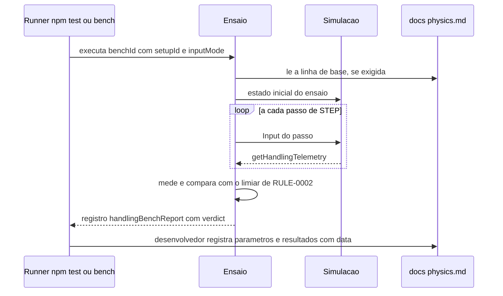

# FLOW-0002 — Ensaio determinístico e volta do piloto de teste

Como um ensaio de [RULE-0002](../rules/RULE-0002-ensaios-e-limiares.md) é executado por `npm test`,
`npm run bench:handling` ou do bench de física, como a linha de base entra no veredito e como a saída
é registrada em `docs/physics.md`. Realiza [FEAT-0005](../features/FEAT-0005-determinismo-piloto-de-teste-e-versao.md)
e [FEAT-0006](../features/FEAT-0006-requisitos-transversais.md). Roda sem rede e sem DOM (D-FS-08, NFR-0005).
Não recebe evento externo (D-FS-03).

## Passos

| Passo | Ator | Ação | Estado | Fonte |
|---|---|---|---|---|
| 1 | Runner | Executa o ensaio com `setupId`, `setupVersion` corrente e `inputMode` (`BINARY` e, para US-0001 a US-0004, também `PROPORTIONAL`) | | NFR-0003 |
| 2 | Ensaio | Lê a linha de base de `docs/physics.md` quando o ensaio a exige (`UNDERSTEER_ONSET`, `STEP_COST`) | `baselineAvailable` | NFR-0004; US-0002, caso anormal |
| 3 | Ensaio | Coloca a simulação no estado inicial do ensaio (reta a 50 km/h; entrada da curva a 50 km/h; parado; largada da pista sintética) | `simStepCount` 0 | [RULE-0002](../rules/RULE-0002-ensaios-e-limiares.md) |
| 4 | Ensaio e simulação | Aplica o `Input` do passo e avança `STEP`; lê a telemetria ([API-0001](../api/API-0001-telemetria-de-dirigibilidade.md)) | `simStepCount` + 1 por passo | I9 |
| 5 | Ensaio | Mede (tempos em passos de `STEP` convertidos em ms; velocidades em km/h; derrapagem em rad) e compara com o limiar | | [RULE-0002](../rules/RULE-0002-ensaios-e-limiares.md) |
| 6 | Ensaio | Emite o registro de [API-0003](../api/API-0003-saida-dos-ensaios.md) com `verdict` e, em `FAIL`, `failReason` | | AC-US-0001-06, AC-US-0002-05, AC-US-0003-07, AC-US-0004-07, AC-US-0005-02, AC-US-0005-03 |
| 7 | Ensaio `DETERMINISM` | Repete cada ensaio e a volta do piloto de teste pelo menos 2 vezes e compara estados e tempos passo a passo | | AC-US-0005-01, NFR-0001 |
| 8 | Desenvolvedor | Registra em `docs/physics.md`, com data, os parâmetros e os resultados ao lado da linha de base, para o Arcade assistido e para o Realista | | NFR-0004, NFR-0007 |

A volta do piloto de teste (`TEST_PILOT_LAP`) usa a sequência binária de comandos na pista sintética, com a
largada, os setores e a validação de `race-lap-validation` inalterados (NFR-0008); reporta `lapTimeMs`,
`sectorMs`, `offAsphaltStepCount` e `meanStepCostUs`.

## Alternativas, erros e eventos fora de ordem

| Situação | Tratamento |
|---|---|
| Linha de base ausente | `FAIL` com `BASELINE_MISSING`; o critério não é julgado até a linha de base ser registrada; nada é extrapolado |
| Piloto de teste sai do asfalto | `FAIL` com `OFF_ASPHALT`, com `offAsphaltFirstStep` e posição; a feature não é entregue com esse resultado |
| Tempo do piloto de teste acima de 25 s | `FAIL` com `THRESHOLD_EXCEEDED`; nenhum afrouxamento do limite |
| Duas execuções com tempos ou estados diferentes | `FAIL` com `NON_DETERMINISTIC`; defeito, nunca tolerância |
| `understeer` durante `STEER_RESPONSE` | Contado em `understeerStepCount`; não altera o veredito (AC-US-0001-05) |
| Ensaio com `inputMode` `PROPORTIONAL` aprovado e `BINARY` reprovado, ou o inverso | O critério não é atendido: exige `PASS` nas duas formas (NFR-0003) |
| Acelerador solto antes de 60 km/h em `ACCELERATION` | O ensaio não ocorre assim: o acelerador é mantido cheio por definição; soltar interrompe o ensaio sem exigência de tempo (US-0004, caso anormal) |
| Nenhum contato em `WALL_CONTACT` | `FAIL`: o ensaio exige ao menos um contato com velocidade maior que 0 |
| Contato com a parede a velocidade 0 | Não há contato novo a julgar; não entra em `contacts` (US-0004, caso anormal) |
| Ensaio com o Realista | Mesmos ensaios; veredito é identidade com a linha de base do Realista, não os limiares do Arcade (NFR-0007) |
| Custo por passo medido em máquina ou runtime diferente da linha de base | Não comparável; `STEP_COST` só é julgado contra a linha de base da mesma máquina e runtime (NFR-0002) |
| Rodada de acerto reprovada pelo dono do produto em staging (`DOMAIN/DEC-10`) | Os presets são iterados dentro do pipeline; a rodada seguinte é nova `setupVersion` ([RULE-0003](../rules/RULE-0003-versao-do-acerto-e-comparabilidade.md)) e todos os ensaios desta tabela são executados de novo contra os mesmos limiares, com nova entrada datada em `docs/physics.md` (NFR-0004) |
| Rede indisponível | Sem efeito |
