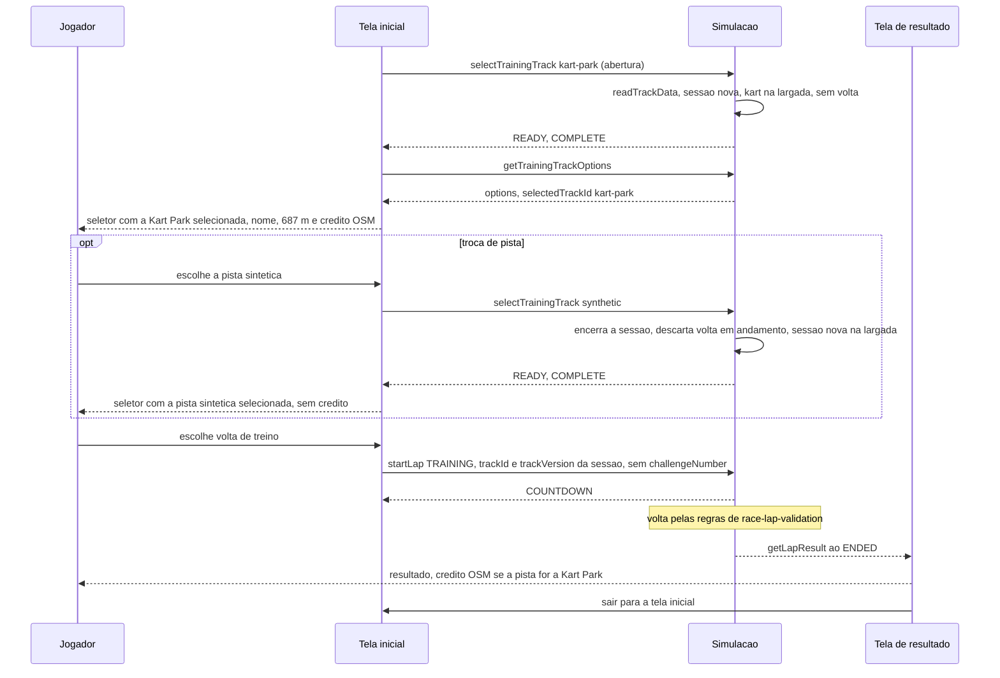

# FLOW-0001 — Abertura do jogo, escolha e troca de pista no treino

Como o jogo abre na Kart Park, como o Jogador troca de pista pelo seletor e como uma volta de treino é
iniciada na pista escolhida, em `web-desktop` e `web-mobile`. Realiza
[FEAT-0001](../features/FEAT-0001-seletor-de-pista-no-treino.md) e a parte de seletor e de resultado de
[FEAT-0006](../features/FEAT-0006-credito-nome-e-comprimento.md). Roda sem rede: o catálogo e os arquivos
de pista vêm com os arquivos do jogo, e nenhuma requisição é feita entre a escolha da pista e o fim da
volta (D-FS-08, NFR-0004). Nenhum evento externo entra neste fluxo; os pedidos do Jogador são locais e
ordenados pela ordem em que chegam, e a repetição de uma seleção é tratada na simulação pela regra de
idempotência de [API-0002](../api/API-0002-catalogo-e-selecao-da-pista-do-treino.md) (D-FS-03).

## Passos

| Passo | Ator | Ação | Estado | Fonte |
|---|---|---|---|---|
| 1 | Tela inicial | Na abertura do jogo, pede `selectTrainingTrack` com `kart-park`, sem ação do Jogador e sem ler escolha anterior | `sessionState` `LOADING` | AC-US-0001-02 |
| 2 | Simulação | Lê o dado da pista com `readTrackData` ([API-0001](../api/API-0001-dado-de-pista-com-geometria-zebras-e-barreiras.md)); com dado utilizável, abre a sessão nova: kart na `startPosition`, nenhuma volta | `READY`; `getLapState` `NO_ACTIVE_LAP` | AC-US-0001-03, AC-US-0001-06, AC-US-0001-07 |
| 3 | Tela inicial | Lê `getTrainingTrackOptions` e exibe as duas opções, a selecionada, o nome e "687 m" na opção da Kart Park e, se a selecionada tem `osmCredit`, a linha de crédito ([SCR-0001](../screens/SCR-0001-tela-inicial-com-seletor-de-pista.md)) | | AC-US-0001-01, AC-US-0006-01 |
| 4 | Jogador | Escolhe a outra opção no seletor | | AC-US-0001-04 |
| 5 | Simulação | `selectTrainingTrack` com a pista escolhida: encerra a sessão corrente, descarta sem resultado uma volta não encerrada, abre a sessão nova na largada da pista escolhida | `LOADING`, depois `READY` | AC-US-0001-06, AC-US-0001-07 |
| 6 | Jogador | Escolhe volta de treino, a única oferecida | | AC-US-0001-05 |
| 7 | Tela inicial | Pede `startLap` de `race-lap-validation` com `lapKind` `TRAINING`, o `trackId` e o `trackVersion` da sessão e sem `challengeNumber` | `lapPhase` `COUNTDOWN` | AC-US-0001-03, AC-US-0001-04, AC-US-0001-05 |
| 8 | Simulação | Conduz a volta pelas regras de `race-lap-validation` ([FLOW-0002](FLOW-0002-passo-de-simulacao-na-kart-park.md)) até `ENDED` | `ENDED` | US-0003 |
| 9 | Tela de resultado | Exibe o resultado de `race-lap-validation` e, se a pista da volta tem `osmCredit`, a linha de crédito ([SCR-0002](../screens/SCR-0002-credito-na-tela-de-resultado.md)); nada é gravado como tentativa ou resultado de desafio diário | | AC-US-0001-05, AC-US-0006-04 |
| 10 | Jogador | Sai da tela de resultado para a tela inicial (navegação de `race-lap-validation`); pode escolher outra pista (passo 4) ou outra volta (passo 6) | | US-0001, Pré-condições |

## Alternativas, erros e eventos fora de ordem

| Situação | Tratamento |
|---|---|
| Dado da pista escolhida `UNREADABLE` ou `UNSUPPORTED_SCHEMA` | `sessionState` `FAILED`; a tela inicial exibe o erro e não oferece volta; as duas opções continuam selecionáveis; o arquivo fica intacto (I4) |
| Jogador escolhe a opção que já é a da sessão `READY` | Sem efeito ([API-0002](../api/API-0002-catalogo-e-selecao-da-pista-do-treino.md), idempotência) |
| Duas escolhas em sequência rápida | Atendidas na ordem; vale a última; cada uma abre sessão nova na largada |
| Escolha de outra pista com volta não encerrada | A volta é descartada sem resultado e não continua; a sessão nova não tem volta em andamento |
| Recarregar ou abandonar a página em qualquer passo | O jogo reabre no passo 1, com a Kart Park; volta em andamento sem resultado (regra de `race-lap-validation`); nada gravado |
| Perder o foco da aba durante a volta | Pausa de `race-lap-validation`; a pista da sessão não muda |
| Sensor ausente ou permissão negada (`web-mobile`) | Toque com estado visível; seletor, sessão e largada inalterados |
| `startLap` rejeitado (`LAP_ALREADY_ACTIVE` e as demais rejeições de `race-lap-validation`) | Sem efeito, como em `race-lap-validation`; a sessão não muda |
| Jogador aciona o link do crédito | O navegador abre o destino; é a única navegação a outro serviço, por ação do Jogador (NFR-0004) |
| Rede indisponível | Sem efeito em nenhum passo |
