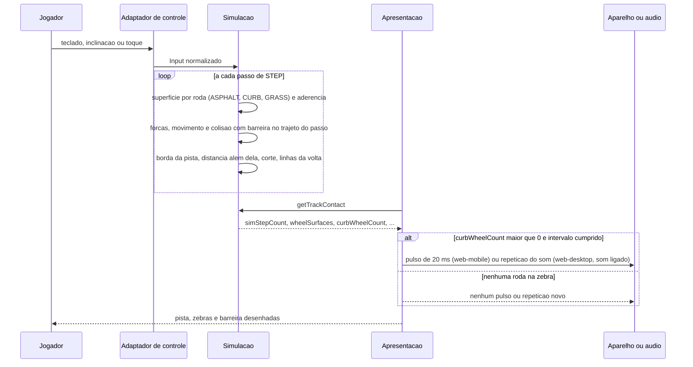

# FLOW-0002 — Passo de simulação na Kart Park e retorno da zebra

O que acontece em cada passo de `STEP` com a Kart Park carregada: a superfície sob cada roda, a aderência,
a borda da pista para o corte, a colisão com a barreira, a passagem pelas linhas da volta, e o retorno da
zebra que a apresentação dispara a partir do estado. Realiza [FEAT-0003](../features/FEAT-0003-setores-chegada-marcadores-e-validacao.md),
[FEAT-0004](../features/FEAT-0004-barreira-nos-trechos-quase-encostados.md) e
[FEAT-0005](../features/FEAT-0005-zebra-com-efeito.md). Roda sem rede: nenhuma requisição entre o `Input`
e o retorno (D-FS-08). Nenhum evento externo entra neste fluxo; o retorno da zebra é deduplicado pela
apresentação por `simStepCount`, de modo que o mesmo passo não começa dois pulsos nem duas repetições
(D-FS-03).

## Passos

| Passo | Ator | Ação | Estado | Fonte |
|---|---|---|---|---|
| 1 | Jogador | Pilota pelo teclado (`web-desktop`), pela inclinação e toque ou só pelo toque (`web-mobile`) | volta em andamento | US-0003 a US-0005, Canais |
| 2 | Adaptador de controle | Entrega o `Input` normalizado, sem campo novo e sem regra de pista (NFR-0008, I2) | | NFR-0008 |
| 3 | Simulação | Classifica a superfície de cada roda pela posição dela: asfalto, zebra ou grama ([RULE-0001](../rules/RULE-0001-superficie-borda-da-pista-e-obstaculos.md)); dá à roda em `CURB` 85 % da aderência do asfalto e as demais regras de pista | `simStepCount` + 1 | AC-US-0005-04, AC-US-0005-06 |
| 4 | Simulação | Avança o movimento com `step(state, input, dt)`; se o trajeto do kart no passo encontra uma barreira, aplica a mesma resposta de colisão do muro existente e marca `barrierContact`; o kart nunca termina o passo do outro lado | | AC-US-0004-04, AC-US-0004-05 |
| 5 | Simulação | Calcula `beyondTrackEdgeM` a partir da borda da pista (asfalto ou zebra) e aplica a regra de corte de `race-lap-validation` com 3 m e 1000 ms | `offTrackMs` de `race-lap-validation` | AC-US-0003-07, AC-US-0005-05 |
| 6 | Simulação | Detecta a passagem pelos marcadores, pelos limites de setor e pela chegada nas linhas transversais do arquivo, com as regras de `race-lap-validation` | `markersPassedCount`, `completedSectorMs`, `lapValidity` | AC-US-0003-05, AC-US-0003-10 |
| 7 | Apresentação | Lê `getTrackContact` a cada passo avançado e, para um `simStepCount` ainda não tratado, decide o retorno da zebra por [RULE-0004](../rules/RULE-0004-retorno-da-zebra.md) | | AC-US-0005-07, AC-US-0005-09 |
| 8 | Apresentação | Em `web-mobile`, pede ao aparelho um pulso de 20 ms; em `web-desktop`, com o som ligado, começa a repetição do som da zebra | | AC-US-0005-07, AC-US-0005-09 |
| 9 | Apresentação | Desenha o asfalto, as zebras no lado declarado e a barreira em todo o comprimento ([SCR-0003](../screens/SCR-0003-kart-park-na-tela-de-corrida.md)) | | US-0002, US-0004, US-0005 |

A sequência de `Input` por passo é a única entrada da simulação: a mesma sequência, a partir do mesmo
estado, dá as mesmas superfícies, a mesma colisão, os mesmos cruzamentos e o mesmo tempo (NFR-0003). O
retorno da zebra não volta para a simulação.

## Alternativas, erros e eventos fora de ordem

| Situação | Tratamento |
|---|---|
| Roda sobre a zebra e outra na grama | Cada roda segue a sua superfície; o corte é medido da borda externa da zebra |
| Kart rápido contra a barreira | O contato é decidido no trajeto do passo; nenhum passo termina do outro lado |
| Pausa, perda de foco, perda do sensor | A simulação fica suspensa; `simStepCount` não avança; nenhum pulso nem repetição novo; um pulso já começado termina os seus 20 ms |
| Taxa de quadros baixa | Superfície, colisão, corte e cruzamentos são função dos passos, não dos quadros; a apresentação trata cada `simStepCount` uma vez, mesmo que vários passos avancem num quadro |
| Navegador sem vibração ou que a bloqueia (`web-mobile`) | Nenhum pulso; nada mais muda; nenhum aviso |
| Som desligado (`web-desktop`) | Nenhuma repetição do som da zebra |
| Sensor ausente ou permissão negada antes da volta (`web-mobile`) | O adaptador recai para toque com estado visível; nada neste fluxo muda |
| `getTrackContact` sem estado | `NO_STATE`; nenhum retorno da zebra |
| Rede indisponível | Sem efeito: nenhuma requisição neste fluxo |
