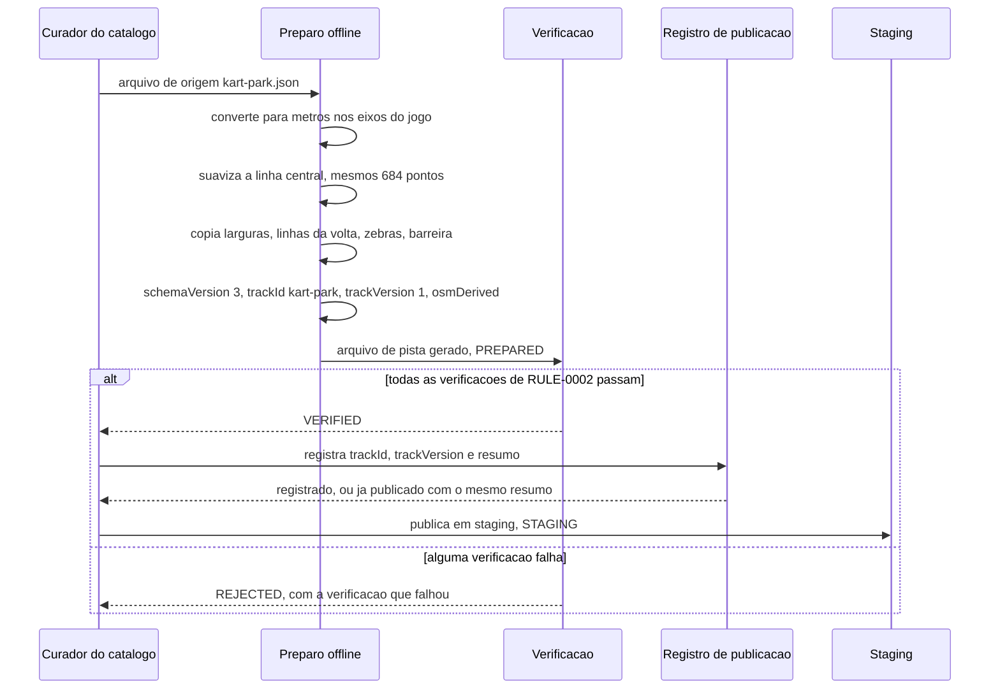

# FLOW-0003 — Preparo offline, verificação e publicação do arquivo de pista da Kart Park

Como o Curador do catálogo transforma o arquivo de origem no arquivo de pista que o jogo lê, como o arquivo
é verificado e como é publicado. Realiza o lado de dado de [FEAT-0002](../features/FEAT-0002-forma-largura-e-versao-do-arquivo-de-pista.md),
[FEAT-0003](../features/FEAT-0003-setores-chegada-marcadores-e-validacao.md),
[FEAT-0004](../features/FEAT-0004-barreira-nos-trechos-quase-encostados.md) e
[FEAT-0005](../features/FEAT-0005-zebra-com-efeito.md), e a publicação de
[FEAT-0007](../features/FEAT-0007-requisitos-transversais.md). É offline e fica fora do cliente (I10): o
jogo não executa nenhum passo deste fluxo e não precisa de rede para ler o resultado dele (D-FS-08). O
evento externo é a publicação de uma versão: ela é deduplicada no registro de publicação, por `trackId`,
`trackVersion` e resumo do arquivo ([RULE-0005](../rules/RULE-0005-versao-e-publicacao-da-pista.md),
D-FS-03).

## Passos

| Passo | Ator | Ação | Estado | Fonte |
|---|---|---|---|---|
| 1 | Curador do catálogo | Toma o arquivo de origem (`kart-park.json`, `kartle-pista` v1), sem alterá-lo | | US-0002, Pré-condições |
| 2 | Preparo offline | Converte os pontos para metros nos eixos do jogo (leste = +x, norte = −z) | | AC-US-0002-04 |
| 3 | Preparo offline | Suaviza a linha central, mantendo a quantidade e a ordem dos pontos; a janela de cerca de 12 m é orientação do design (`DOMAIN/DEC-04`) | | AC-US-0002-06 |
| 4 | Preparo offline | Copia a largura de cada ponto da origem para o ponto correspondente | | AC-US-0002-05 |
| 5 | Preparo offline | Declara a largada e a chegada no ponto 0, os três limites de setor nos pontos de [RULE-0002](../rules/RULE-0002-geometria-e-verificacoes-do-arquivo-de-pista.md) e os marcadores a no máximo 25 m, como linhas transversais | | AC-US-0003-02, AC-US-0003-04 |
| 6 | Preparo offline | Leva as 33 zebras da origem para a linha suavizada por índice fracionário, dividindo no ponto 0 a que cruza a largada; declara a largura de cada uma | | AC-US-0005-01, AC-US-0005-02 |
| 7 | Preparo offline | Declara a barreira entre os trechos quase encostados, na grama | | AC-US-0004-01 |
| 8 | Preparo offline | Declara `schemaVersion` 3, `trackId` `kart-park`, `trackVersion` 1, `direction` `COUNTER_CLOCKWISE` e `osmDerived` verdadeiro; não copia nome, comprimento oficial nem recorde | `publicationState` `PREPARED` | NFR-0006, AC-US-0006-09 |
| 9 | Verificação | Executa todas as verificações de [RULE-0002](../rules/RULE-0002-geometria-e-verificacoes-do-arquivo-de-pista.md) sobre o arquivo gerado e o de origem, de forma determinística | `VERIFIED` se todas passam, `REJECTED` se alguma falha | AC-US-0002-01 a AC-US-0005-02, NFR-0001 |
| 10 | Curador do catálogo | Com a versão em `VERIFIED`, registra `trackId`, `trackVersion` e o resumo criptográfico do arquivo | `VERIFIED` | NFR-0006 |
| 11 | Curador do catálogo | Publica em staging; a promoção para produção espera a decisão sobre a licença Esri | `STAGING` | NFR-0012 |

## Alternativas, erros e eventos fora de ordem

| Situação | Tratamento |
|---|---|
| Uma verificação falha (tolerância, comprimento, sentido, bordas, setores, marcadores, zebras, barreira, tamanho) | O arquivo não é publicado; a correção é feita no preparo, e o arquivo corrigido passa de novo por todas as verificações |
| Conversão com outro mapeamento de eixos | O circuito gira no sentido horário; a verificação de sentido reprova |
| Suavização que muda a quantidade de pontos | A verificação de correspondência reprova |
| Publicar de novo o mesmo arquivo com o mesmo `trackVersion` | Sem efeito: o registro já tem o mesmo resumo |
| Publicar conteúdo diferente com um `trackVersion` já registrado | Recusado; a mudança exige `trackVersion` maior ([RULE-0005](../rules/RULE-0005-versao-e-publicacao-da-pista.md)) |
| Promoção para produção sem a decisão sobre a licença Esri registrada em `DOMAIN.md` | Recusada; a versão fica em `STAGING` |
| Arquivo de origem com ponto, largura ou zebra fora do que os requisitos mediram | A verificação correspondente reprova; o arquivo de origem não é corrigido por este fluxo, e uma origem nova é decisão do dono do produto |
