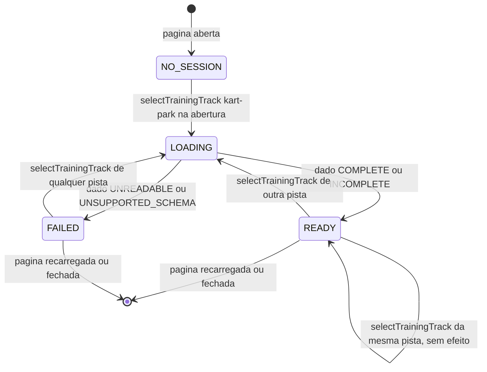

# RULE-0003 — Sessão de treino e seleção de pista

Modelo de estados da sessão de treino, mantido pela simulação e mudado só por `selectTrainingTrack`
([API-0002](../api/API-0002-catalogo-e-selecao-da-pista-do-treino.md)). A tela inicial lê o estado e pede a
seleção; nunca muda a sessão por conta própria (I2). Fontes: `DOMAIN/DEC-01`, `DOMAIN/DEC-06` e os critérios
de US-0001 citados em cada linha. O modelo de estados da volta é de `race-lap-validation` e não muda.

## Enums

| Campo | Valores | Observação |
|---|---|---|
| `sessionState` | `NO_SESSION`, `LOADING`, `READY`, `FAILED` | Estado da sessão de treino |
| `selectedTrackId` | `kart-park`, `synthetic` | Pista do último pedido de seleção; `kart-park` na abertura |

## Diagrama

## Transições

| De | Para | Disparo | Efeito | Idempotente sob repetição | Contador de sequência | Fonte |
|---|---|---|---|---|---|---|
| `NO_SESSION` | `LOADING` | Abertura do jogo: `selectTrainingTrack` `kart-park`, sem ação do Jogador | Nenhuma leitura de escolha anterior | Sim: a abertura pede uma vez | nenhum | AC-US-0001-02 |
| `LOADING` | `READY` | Leitura do dado `COMPLETE` ou `INCOMPLETE` | Estado da simulação novo na pista pedida; kart na `startPosition`; nenhuma volta (`NO_ACTIVE_LAP`) | Sim: a leitura do mesmo arquivo dá o mesmo dado | nenhum | AC-US-0001-03, AC-US-0001-04, AC-US-0001-06, AC-US-0001-07 |
| `LOADING` | `FAILED` | Leitura do dado `UNREADABLE` ou `UNSUPPORTED_SCHEMA` | Nenhum estado de simulação; nenhuma volta pode começar; arquivo intacto | Sim: a mesma leitura falha do mesmo modo | nenhum | I4 |
| `READY` | `LOADING` | `selectTrainingTrack` com pista diferente da sessão | A sessão é encerrada; volta em `COUNTDOWN`, `RUNNING` ou `PAUSED` descartada sem resultado | Sim no estado final: repetir o pedido leva à mesma sessão nova na largada | nenhum | AC-US-0001-06, AC-US-0001-07 |
| `FAILED` | `LOADING` | `selectTrainingTrack` com qualquer pista do catálogo | Nova tentativa de leitura | Sim: mesmo pedido, mesmo resultado | nenhum | AC-US-0001-03, AC-US-0001-04 |
| `READY` | `READY` | `selectTrainingTrack` com a pista da sessão | Nenhum: a sessão, o kart e a volta não mudam | Sim | nenhum | AC-US-0001-06 |

Nenhuma transição carrega contador de sequência exposto: os pedidos de seleção são locais e atendidos na
ordem em que chegam, um pedido feito durante `LOADING` é atendido depois do corrente, e vale o último. As
voltas de uma sessão têm o contador de sequência de `race-lap-validation` (`stepCount`), sem mudança.

## Regras do modelo

| Regra | Fonte |
|---|---|
| Toda volta pedida numa sessão `READY` vai com `lapKind` `TRAINING`, o `trackId` e o `trackVersion` da sessão e sem `challengeNumber` | AC-US-0001-03, AC-US-0001-04, AC-US-0001-05 |
| Nenhuma transição grava no navegador: nem a pista escolhida, nem a sessão, nem registro de desafio diário (tentativa ou resultado) | AC-US-0001-02, AC-US-0001-05 |
| Encerrar uma sessão nunca produz resultado para a volta que estava nela; uma volta já `ENDED` já teve o seu resultado exibido pela tela de resultado, e nada dele é gravado como desafio diário | AC-US-0001-05, AC-US-0001-07 |
| Recarregar ou fechar a página encerra a sessão como em `race-lap-validation` (nenhum resultado para volta não encerrada); a reabertura começa em `NO_SESSION` e volta à Kart Park | AC-US-0001-02 |
| A perda do sensor ou da permissão em `web-mobile` não muda `sessionState` nem `selectedTrackId` | I4 |
