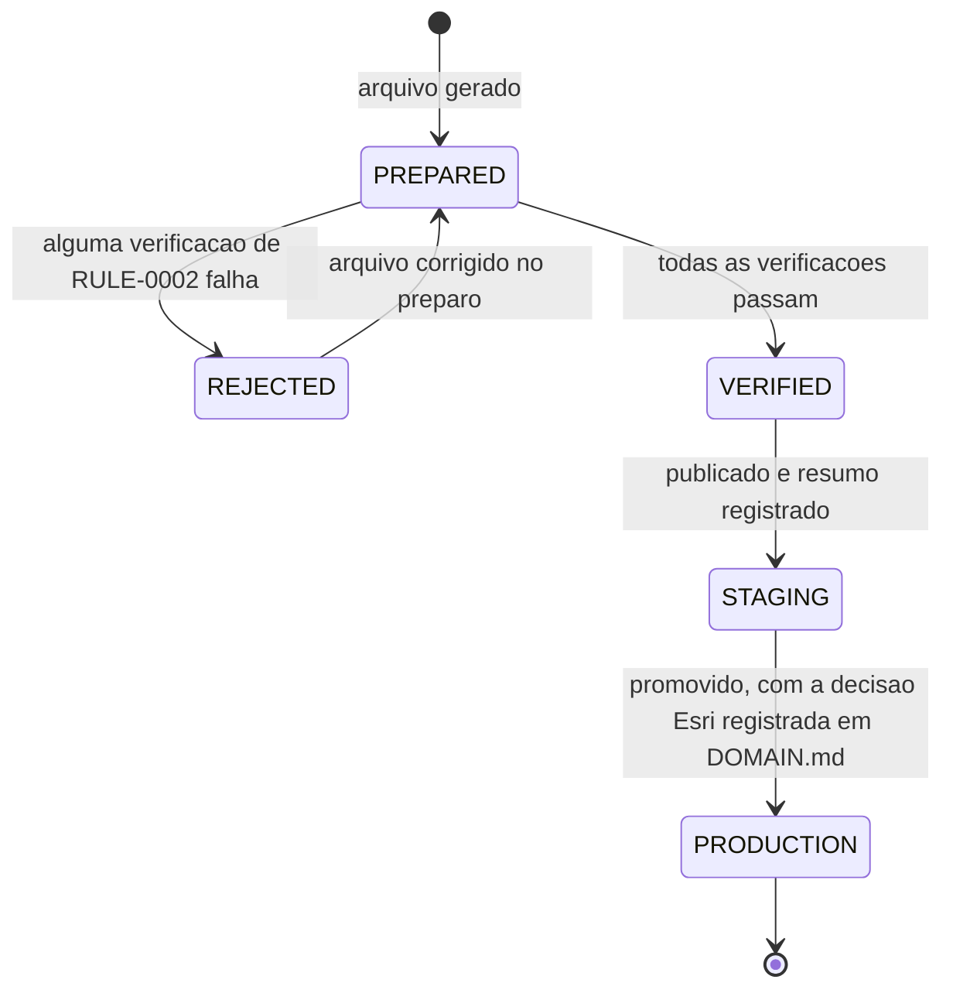

# RULE-0005 — Versão e publicação da pista Kart Park

Estados de uma versão do arquivo de pista da Kart Park, do preparo à produção, e a regra de imutabilidade
(I3, I5). Decidido no preparo offline e na etapa de deploy, fora do cliente (I10). Fontes: NFR-0006,
NFR-0012, `DOMAIN/DEC-02`, `DOMAIN/DEC-08`.

## Enums

| Campo | Valores | Observação |
|---|---|---|
| `publicationState` | `PREPARED`, `REJECTED`, `VERIFIED`, `STAGING`, `PRODUCTION` | Estado de uma versão (`trackId` + `trackVersion`) |

## Diagrama

## Transições

| De | Para | Disparo | Idempotente sob repetição | Contador de sequência | Fonte |
|---|---|---|---|---|---|
| `PREPARED` | `REJECTED` ou `VERIFIED` | Verificações de [RULE-0002](RULE-0002-geometria-e-verificacoes-do-arquivo-de-pista.md) | Sim: as verificações são funções puras do arquivo | nenhum | NFR-0006 |
| `REJECTED` | `PREPARED` | Arquivo corrigido no preparo, ainda não publicado | Sim | nenhum | NFR-0006 |
| `VERIFIED` | `STAGING` | Publicação: registro de `trackId`, `trackVersion` e resumo criptográfico do arquivo | Sim: publicar de novo o mesmo arquivo com o mesmo `trackVersion` encontra o mesmo resumo e não cria versão | `trackVersion` | NFR-0006 |
| `STAGING` | `PRODUCTION` | Promoção pela etapa de deploy | Sim: promover de novo a mesma versão não muda nada | `trackVersion` | NFR-0012 |

`trackVersion` é o contador de sequência das versões: cresce de uma versão publicada para a seguinte e
nunca é reusado.

## Regras

| Regra | Fonte |
|---|---|
| A primeira versão publicada da Kart Park é `trackVersion` 1 | NFR-0006 |
| Depois de `STAGING`, o arquivo de uma versão nunca muda: o resumo do arquivo entregue é igual ao registrado, com 0 bytes alterados | NFR-0006 |
| Publicar conteúdo diferente com um `trackVersion` já registrado é recusado | NFR-0006 (I3) |
| Suavizar de novo ou mudar a linha central, uma largura, uma zebra, a barreira, os setores ou os marcadores produz um arquivo novo com `trackVersion` maior que o da versão anterior, que passa de novo por `PREPARED` | NFR-0006 |
| A promoção de `STAGING` para `PRODUCTION` com a Kart Park só ocorre com a decisão do dono do produto sobre a licença Esri registrada em `DOMAIN.md`; antes dela, a Kart Park fica só em staging | NFR-0012; `DOMAIN/DEC-08` |
| A licença Esri não bloqueia nenhuma etapa de especificação nem a publicação em staging | NFR-0012; `DOMAIN/DEC-02` |
| Se a decisão liberar a licença, a entrega que promover a Kart Park exibe o crédito da Esri junto ao crédito OSM nas duas telas ([FEAT-0006](../features/FEAT-0006-credito-nome-e-comprimento.md)) | NFR-0012; `DOMAIN/DEC-07` |
| Uma versão anterior publicada nunca é apagada nem editada para dar lugar a uma nova | I3, I5 |
