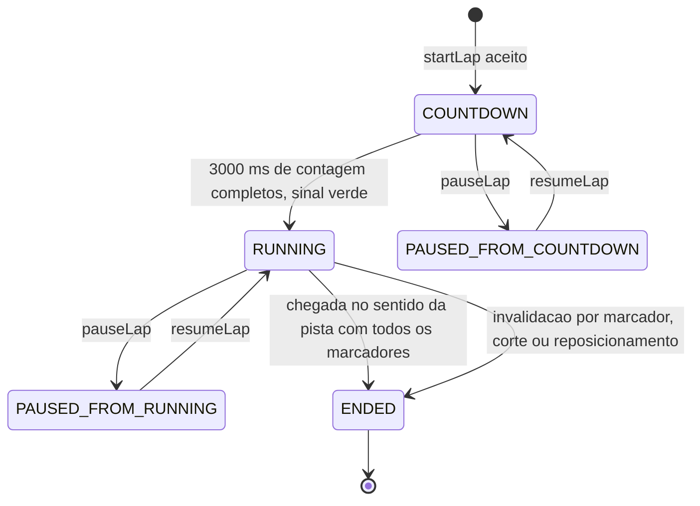

# RULE-0002 — Estados da volta

Modelo de estados da volta, mantido pela simulação. A apresentação lê o estado e nunca o altera (I2).

## Enums

| Campo | Valores | Observação |
|---|---|---|
| `lapPhase` | `COUNTDOWN`, `RUNNING`, `PAUSED`, `ENDED` | Fase da volta |
| `resumePhase` | `COUNTDOWN`, `RUNNING` | Só em `PAUSED`: fase a que a volta retorna ao continuar |
| `pauseCause` | `ESC_KEY`, `FOCUS_LOST`, `SENSOR_LOST` | Causa da pausa; `ESC_KEY` só em `web-desktop`, `SENSOR_LOST` só em `web-mobile` |
| `lapValidity` | `VALID`, `INVALID` | Ver [RULE-0001](RULE-0001-validade-da-volta.md) |
| `invalidReason` | `MISSED_MARKER`, `CUT`, `REPOSITION` | Presente só com `lapValidity` `INVALID` |
| `lapKind` | `OFFICIAL`, `RECON`, `TRAINING` | Fixado ao iniciar a volta; não muda |

## Contadores

| Contador | Significado | Avança quando |
|---|---|---|
| `countdownRemainingMs` | Tempo de simulação que falta para o sinal verde; começa em 3000 | A cada passo em `COUNTDOWN` |
| `stepCount` | Passos de `STEP` contados do sinal verde; é o contador de sequência de todas as transições da volta | A cada passo em `RUNNING`; nunca em `COUNTDOWN`, `PAUSED` ou `ENDED` |
| `elapsedMs` | Tempo da volta: N × `STEP` após N passos do sinal verde, em ms (ver [RULE-0003](RULE-0003-cronometragem-e-interpolacao.md)) | Junto com `stepCount` |
| `markersPassedCount` | Marcadores passados em ordem ([RULE-0001](RULE-0001-validade-da-volta.md)) | Ver RULE-0001 |
| `sectorsCompletedCount` | Setores completados de 0 a 4 | Ao cruzar o limite do setor seguinte |
| `offTrackMs` | Duração contínua além da distância dos limites de corte ([RULE-0004](RULE-0004-corte-e-grama.md)) | Ver RULE-0004 |

## Diagrama

`PAUSED_FROM_COUNTDOWN` e `PAUSED_FROM_RUNNING` são o valor `PAUSED` do enum com `resumePhase` `COUNTDOWN` e
`RUNNING`, respectivamente.

## Transições

| De | Para | Disparo | Idempotente sob repetição | Contador de sequência | Fonte |
|---|---|---|---|---|---|
| (nenhuma) | `COUNTDOWN` | `startLap` aceito | Não cria segunda volta: com volta não encerrada, o pedido é rejeitado (`LAP_ALREADY_ACTIVE`) | nenhum (`stepCount` = 0) | AC-US-0001-01 |
| `COUNTDOWN` | `RUNNING` | `countdownRemainingMs` chega a 0 | Sim: acontece uma vez | `stepCount` passa a contar do passo seguinte | AC-US-0001-05; `DOMAIN/DEC-05` |
| `COUNTDOWN` ou `RUNNING` | `PAUSED` | Esc, perda de foco, perda do sensor | Sim: pausar com a volta já em `PAUSED` não faz nada e não troca `resumePhase` | `stepCount` fica congelado | AC-US-0003-05 a AC-US-0003-08; `DOMAIN/DEC-08` |
| `PAUSED` | `resumePhase` | `resumeLap` | Sim: continuar sem pausa não faz nada | `stepCount` retoma do valor congelado | AC-US-0003-09 |
| `RUNNING` | `ENDED` | Conclusão ou invalidação ([RULE-0001](RULE-0001-validade-da-volta.md)) | Sim: a volta encerrada ignora novos eventos | `stepCount` do passo de encerramento | AC-US-0005-03; `DOMAIN/DEC-06` |

Não existe transição de `ENDED` para outra fase: uma nova volta é uma nova volta, com novo `startLap`.

## Regras do modelo

| Regra | Fonte |
|---|---|
| Durante `PAUSED` nenhum passo de `STEP` avança e nenhum contador muda | AC-US-0003-08 |
| `PAUSED` não altera `lapValidity` nem `lapKind`; a volta pausada e continuada segue oficial | AC-US-0003-09 |
| Perda de foco e perda do sensor ao mesmo tempo formam uma única pausa | US-0003, caso anormal |
| A volta deixa `PAUSED` somente por `resumeLap` do Jogador; o retorno do foco da aba não a retoma | AC-US-0003-06; AC-US-0003-05 |
| Em `COUNTDOWN` o cronômetro exibido é zero e o kart fica parado | AC-US-0001-04, AC-US-0001-06 |
| Um comando é aplicado no próximo passo que roda, ou imediatamente se não houver passo (pausa); o "passo do pedido" é esse passo | AC-US-0007-03 |
| A apresentação exibe o estado em todos os quadros de `RUNNING` até `ENDED` | AC-US-0009-01 |
