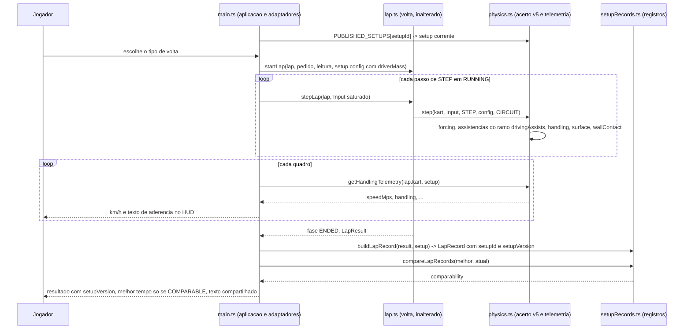
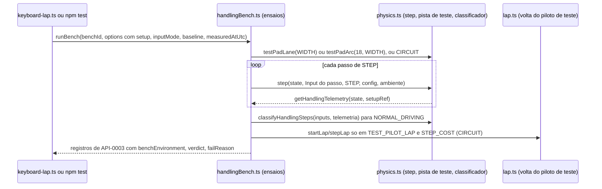

# Arquitetura

Este conjunto projeta como cada `REQ-*` do F-Spec validado de `dirigibilidade` (3.2.0, contra o seed
`revision: 3`; FEAT-0001 a FEAT-0006, API-0001 a API-0003, RULE-0001 a RULE-0003, SCR-0001, SCR-0002,
FLOW-0001 a FLOW-0003) é realizado sobre o código em execução. Os caminhos são relativos à raiz do
repositório (diretriz do estágio: o código vive em `src/`, `tests/`, `scripts/`; `400 Code/Source/` está
vazio). O produto é um cliente de navegador sem servidor, sem conta e sem banco: não existem as pastas
`backend/` e `mobile/` deste estágio. Os itens da simulação ficam em `core/`, os de apresentação em `web/`
(o mesmo cliente serve `web-desktop` e `web-mobile`) e as garantias de privacidade em `security/`.

**Estado do código lido como as-built nesta rodada.** A primeira rodada de código já escreveu, sobre a
versão anterior deste projeto: o preset candidato `ARCADE_ASSISTIDO_V5`, os campos opcionais de
assistência, `PUBLISHED_SETUPS`, `SOLVER_SUBSTEPS`, a condição de forçar, a telemetria por passo e
`getHandlingTelemetry` em `src/physics.ts`; `src/setupRecords.ts` inteiro; e a biblioteca
`scripts/handlingBench.ts`. Esse código é lido aqui como descrição do que o sistema faz hoje, e o projeto
vence onde diverge (as linhas estão em `98-divergences.md`). Não foram escritos: as mudanças de
`src/main.ts`, `index.html`, `scripts/keyboard-lap.ts`, `scripts/physics-bench.ts`, `docs/physics.md`, os
testes `tests/dirigibilidade-*.test.ts` e `src/handlingMessages.ts`.

**O que a revisão 3 do seed muda neste projeto.** A pista sintética (`src/track.ts:3-6`) não tem curva de
raio 18 m: os seus raios discretos mínimos são 24,0 m (índice 0), 25,1 m (índices 53 e 187) e 4,1 m no
grampo (índice 120). Os ensaios de resposta do volante, curva de referência, início do subesterço e
recuperação da traseira passam a rodar na **pista de teste** (`benchEnvironment` `TEST_PAD`): um ambiente
da simulação construído por dois geradores novos em `src/physics.ts`, `testPadLane` (reta: faixa de
largura `WIDTH` ao longo de z) e `testPadArc` (arco: anel de raio 18 m e largura `WIDTH`), sem paredes,
com `surface` `GRASS` fora da faixa ([DES-0001](core/DES-0001-acerto-arcade-assistido-v5-e-assistencias.md),
[ADR-0005](adr/ADR-0005-pista-de-teste-como-ambiente-da-simulacao-e-velocidade-mantida.md)). O ensaio
de resposta do volante mantém a velocidade em 50 km/h com acelerador regulado por passo
(`speedHoldMode` `THROTTLE_REGULATED`, binário por construção) e mede o regime numa janela curta
([DES-0004](core/DES-0004-ensaios-de-dirigibilidade-e-saida.md)). A classe de passo "Recuperação" de
RULE-0001 ganha um classificador puro em `src/physics.ts` (`classifyHandlingSteps`), usado pelo agregado
`NORMAL_DRIVING`. Grama, parede, volta do piloto de teste e custo por passo continuam na pista sintética
(`CIRCUIT`). A varredura de início do subesterço é uma execução contínua no arco, em patamares de
velocidade mantida a partir de 50 km/h, que termina no primeiro passo fora da faixa; a velocidade do kart
nesse passo decide o resultado da saída (RULE-0002, "Fim da varredura de início do subesterço"), e os dois
casos que RULE-0002 deixa sem decisão fazem a biblioteca lançar em vez de emitir um veredito; todo
parâmetro de ensaio, o piloto de teste inclusive, é fixo, e o que o registro de API-0003 não carrega — a
saída da faixa abaixo de 50 km/h nessa varredura e a precondição de `GRASS_LOSS` — chega ao veredito pelo
segundo argumento de `judge`
([ADR-0004](adr/ADR-0004-ensaios-como-biblioteca-e-parametros-de-ensaio.md)).

## Contexto primário (I1)

O contexto primário continua sendo o desafio diário e a pista: todo registro desta feature (replay,
resultado gravado, texto compartilhado) é chaveado em `trackId` + `trackVersion` e, quando o desafio o
informa, em `challengeNumber`, exatamente como o resultado de `race-lap-validation`. A versão do acerto
(`setupId`, `setupVersion`) é um **atributo** do registro, usado só para decidir comparabilidade
([RULE-0003](../../../320%20F-Specs/Output/dirigibilidade/rules/RULE-0003-versao-do-acerto-e-comparabilidade.md));
nenhuma chave, regra ou resultado usa a data, o relógio do aparelho ou o nome do acerto como contexto
primário. O tempo é contado em passos de `STEP`, nunca em tempo de parede. A pista de teste não é dado de
pista publicado: não tem `trackId`, não entra em registro algum e nenhuma tela a exibe.

## Posicionamento por camada (I2)

| Camada | Módulo | Situação | Conteúdo desta feature |
|---|---|---|---|
| Dado de pista | `src/track.ts`, `src/trackData.ts` | inalterados | a pista sintética e o seu leitor não mudam (NFR-0008); `WIDTH` (`src/track.ts:2`) é a largura da faixa da pista de teste (`laneWidthM`) |
| Simulação | `src/physics.ts` | alterado (parte já escrita) | existentes: preset candidato `ARCADE_ASSISTIDO_V5` (`:71-80`), campos opcionais de `KartConfig` (`:40-44`), `PUBLISHED_SETUPS` (`:89-97`), `SOLVER_SUBSTEPS` (`:81`), `isForcing` (`:114-117`), telemetria por passo (`:17-21`, `:291-293`), `stepCount` (`:317`), `getHandlingTelemetry` (`:327-336`). Novos: `testPadLane`, `testPadArc`, `classifyHandlingSteps`, `RECOVERY_MAX_STEPS`, campo opcional `forcingRampMps`. `ARCADE_KART`, `RENTAL_KART`, `KART_PRESETS`, `STEP`, `Input`, `step` e a linha 3 ficam como estão |
| Simulação | `src/maneuvers.ts` | inalterado | a manobra de drift de `requirements/11` não muda |
| Simulação | `src/lap.ts`, `src/lapTiming.ts` | inalterados | ciclo da volta, validade e cronometragem não mudam (NFR-0008); `getLapResult` mantém exatamente os campos de hoje |
| Simulação | `src/setupRecords.ts` | existente (escrito pela rodada de código 1), mantido | leitores e construtores dos registros: `getSetupVersion`, `readReplay`, `compareLapRecords`, `buildLapRecord`, `buildReplayRecord`, `replayLap` (API-0002, RULE-0003) |
| Simulação (lugar na árvore: `scripts/`) | `scripts/handlingBench.ts` | existente, alterado | biblioteca dos ensaios de RULE-0002: um registro de API-0003 por ensaio e variante, com `benchEnvironment`; ambientes por ensaio; leitura da linha de base por ensaio, ambiente e geometria; serialização; usada por `npm test` e pelos benches |
| Aplicação (programa de bench em Node; lugar na árvore: `scripts/`) | `scripts/keyboard-lap.ts`, `scripts/physics-bench.ts` | alterados | pontos de entrada de `bench:handling` e `bench:physics`, que passam a emitir os registros de API-0003; único lugar que lê o relógio de parede (`new Date()` para `measuredAtUtc` nos dois; `node:perf_hooks` para `STEP_COST` e `node:os` para `runtimeId()` só em `scripts/keyboard-lap.ts`) |
| Adaptadores de controle | em `src/main.ts` | inalterados | teclado binário, inclinação proporcional e toque continuam entregando `Input` saturado na faixa; nenhuma regra |
| Aplicação | `src/main.ts` | alterado | escolhe o acerto pelo dado publicado, lê o HUD por `getHandlingTelemetry`, constrói o registro da volta, compara só o comparável, compartilha o texto |
| Aplicação | `src/handlingMessages.ts` | novo | texto compartilhado e rótulo do botão de compartilhar, puros e testáveis sem DOM |
| Aplicação | `index.html` | alterado | linha da `setupVersion` e botão de compartilhar na tela de resultado |

Por que módulos novos (I10): `src/setupRecords.ts` importa `src/lap.ts` (para reproduzir um replay) e
`src/physics.ts`; colocá-lo em `src/physics.ts` faria o modelo do veículo importar a volta, invertendo o
sentido de dependência de `src/lap.ts` → `src/physics.ts`. `scripts/handlingBench.ts` existe porque os ensaios
precisam rodar em `npm test` **e** nos benches com o mesmo código, e `scripts/keyboard-lap.ts` é um
programa, não uma biblioteca. `src/handlingMessages.ts` existe porque `src/main.ts` importa Three.js e o DOM
e não carrega em `npm test`, e `src/lapMessages.ts` (de `race-lap-validation`) só pode importar tipos de
`./lap` (verificado por `tests/race-lap-validation-layering.test.ts`). Os geradores da pista de teste e o
classificador de passo ficam em `src/physics.ts`, e não na biblioteca, porque `Environment`, `CIRCUIT` e
`TEST_PAD` já vivem ali (`src/physics.ts:161-163`) e porque RULE-0001 manda decidir a classe do passo na
simulação (REQ-FEAT-0003-10): a biblioteca só os chama. Dividir `src/main.ts` não faz parte desta feature.

Sentido das dependências (permitido): `setupRecords.ts` importa `physics.ts`, `lap.ts`, `lapTiming.ts`,
`trackData.ts`; `handlingBench.ts` importa `physics.ts`, `lap.ts`, `lapTiming.ts`, `track.ts`,
`trackData.ts`, `setupRecords.ts` e `node:fs` (ler `docs/physics.md` e o texto de `src/physics.ts`) —
**nunca** `node:perf_hooks`, `node:os`, `Date` ou `performance`; `scripts/keyboard-lap.ts` e
`scripts/physics-bench.ts` (programas de bench, camada Aplicação, que só alteram a simulação por
`step`/`stepLap`) importam `handlingBench.ts` e são os únicos a importar `node:perf_hooks` (custo por
passo) e `node:os` (`runtimeId()`) e a ler `new Date()` (`measuredAtUtc`), entregando esses valores à
biblioteca como argumentos; `handlingMessages.ts` importa `lapMessages.ts` e tipos de `setupRecords.ts`;
`main.ts` importa tudo isso. Nenhum módulo de simulação importa `three`, o DOM, `src/audio.ts` ou
`src/main.ts`, nem lê `Date`, `performance.now` ou `Math.random`; o teste de camada de
`race-lap-validation` continua valendo para os módulos que lista e `tests/dirigibilidade-contract.test.ts`
o estende a `src/setupRecords.ts` e `scripts/handlingBench.ts`
([DES-0004](core/DES-0004-ensaios-de-dirigibilidade-e-saida.md)).

## A restrição que molda o projeto: o acerto anterior fica intacto

`tests/race-lap-validation-frozen.test.ts:48-51` afirma, campo a campo, os valores de `ARCADE_KART`, e
`:53-60` que `KART_PRESETS.arcade === ARCADE_KART`, que `PHYSICS_VERSION` e a linha 3 de `src/physics.ts`
não mudam; `tests/race-lap-validation-contract.test.ts:34-41` afirma que `getLapResult` devolve exatamente
os campos de hoje. O F-Spec exige que o conjunto de `race-lap-validation` continue 100 % aprovado
(REQ-FEAT-0006-07) e que a versão anterior do acerto nunca seja editada no lugar (REQ-FEAT-0005-09). As
duas exigências se realizam juntas por
[ADR-0001](adr/ADR-0001-versao-do-acerto-como-registro-novo-no-codigo.md): o novo acerto é um **registro
novo** (`ARCADE_ASSISTIDO_V5`, já em `src/physics.ts:71-80` como candidato) e `ARCADE_KART`
(`src/physics.ts:60-67`) permanece em código como o registro da versão anterior (`previousSetupVersion`); o
resultado gravado é um registro próprio (`LapRecord`) que envolve o `LapResult` sem alterá-lo
([ADR-0002](adr/ADR-0002-formato-do-replay-e-registro-de-volta-em-memoria.md)). Nenhum feedback à
feature `race-lap-validation` é necessário.

## Fluxo alterado

Os ensaios ([FLOW-0002](../../../320%20F-Specs/Output/dirigibilidade/flows/FLOW-0002-ensaio-deterministico-e-piloto-de-teste.md))
seguem o caminho abaixo, sem `main.ts`, com `scripts/handlingBench.ts` no lugar da aplicação:

A leitura de replay ([FLOW-0003](../../../320%20F-Specs/Output/dirigibilidade/flows/FLOW-0003-leitura-de-replay-e-comparacao.md))
é `readReplay` → `getSetupVersion` → `compareLapRecords`, e a reprodução opcional é `replayLap`, que chama
`startLap`/`stepLap` com o acerto corrente.

## Dependências externas

Nenhuma. Não há rede, biblioteca nova, serviço nem armazenamento: o dado publicado é literal em
`src/physics.ts`, os registros vivem na memória da página e nos fixtures, e a linha de base está em
`docs/physics.md`. Não há tempo-limite, política de nova tentativa nem chave de idempotência de rede a
declarar (D-DS-03); a idempotência é a de leituras puras e de funções sobre estado imutável (cada DES nomeia
a sua). A Web Share API é usada pela aplicação quando o navegador a oferece, com recuo para a área de
transferência; a sua falha não altera nenhum registro.

## Estratégia de compatibilidade

| Contrato | Tratamento |
|---|---|
| Presets e `KART_PRESETS` | intactos; o novo acerto é um registro novo; a aplicação passa a ler `PUBLISHED_SETUPS` |
| `LapResult` de `race-lap-validation` | intacto; `LapRecord` = `LapResult` + `setupId` + `setupVersion`, construído por esta feature |
| Replay | formato novo, versão 1 ([DM-0001](data/DM-0001-dado-publicado-registros-e-linha-de-base.md)); a forma anterior à feature (sem `setupVersion`) é lida com `RESOLVED_FROM_ABSENCE`; versão maior é `UNSUPPORTED_FORMAT`, intacta |
| `STEP`, solver de 480 Hz, `Input` | inalterados; `SOLVER_SUBSTEPS` (`src/physics.ts:81`) só nomeia o valor que `step` usa em `:298` |
| Dado de pista | inalterado (`schemaVersion` 2, `trackVersion` 2); a pista de teste não é dado de pista |
| `TEST_PAD` (constante de `src/physics.ts:163`) | intacta: asfalto sem limite, usada por `tests/physics.test.ts` e `scripts/physics-bench.ts`; os geradores `testPadLane`/`testPadArc` são acréscimos |
| Saída dos benches existentes | os campos que `scripts/physics-bench.ts` já imprime continuam; os registros de API-0003 são acrescentados |
| Linha de base em `docs/physics.md` | bloco novo; uma entrada só vale para o ensaio, o ambiente e a geometria em que foi medida (`BASELINE_MISSING` fora disso) |

## Rastros de decisão

| ADR | Decisão |
|---|---|
| [ADR-0001](adr/ADR-0001-versao-do-acerto-como-registro-novo-no-codigo.md) | a nova versão do acerto é um registro novo em código; a anterior fica intacta; não há chave mestra |
| [ADR-0002](adr/ADR-0002-formato-do-replay-e-registro-de-volta-em-memoria.md) | formato do replay versão 1 e registro de volta que envolve o `LapResult`, sem persistência |
| [ADR-0003](adr/ADR-0003-linha-de-base-legivel-por-maquina-em-docs-physics.md) | linha de base legível por máquina dentro de `docs/physics.md`, resolvida por ensaio, ambiente e geometria; identidade de máquina e runtime sem dado pessoal |
| [ADR-0004](adr/ADR-0004-ensaios-como-biblioteca-e-parametros-de-ensaio.md) | ensaios como biblioteca em `scripts/` compartilhada por `npm test` e pelos benches; parâmetros de ensaio fixos, o piloto de teste inclusive; o que o registro não carrega pelo segundo argumento de `judge`; varredura de `UNDERSTEER_ONSET` em patamares de velocidade mantida até a primeira saída da faixa, decidida pela velocidade nesse passo; entrada do Realista e registros antigos como opções da biblioteca |
| [ADR-0005](adr/ADR-0005-pista-de-teste-como-ambiente-da-simulacao-e-velocidade-mantida.md) | pista de teste como geradores de `Environment` em `src/physics.ts` (reta e arco de 18 m, largura `WIDTH`); velocidade mantida por acelerador regulado por passo; classificador de passo na simulação |
