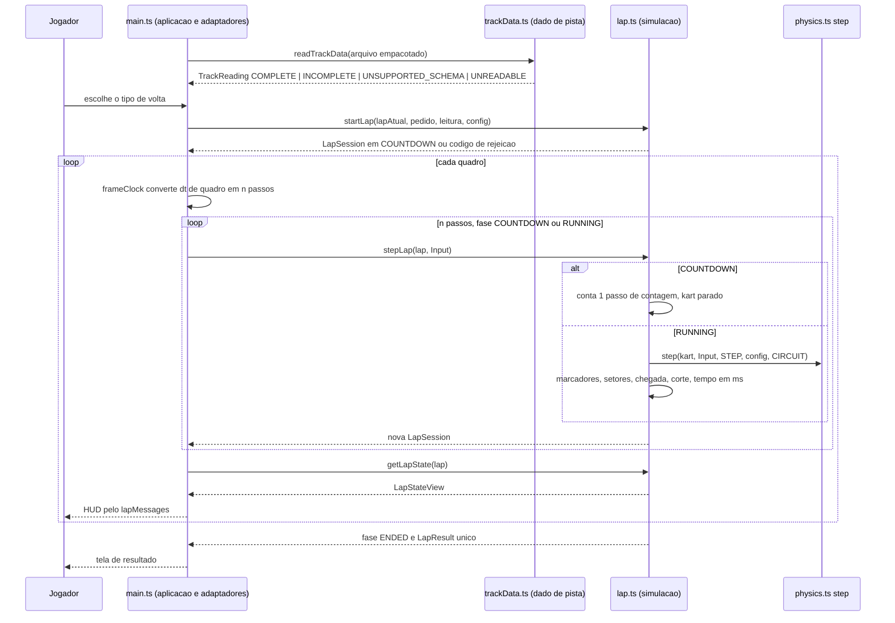

# Arquitetura

Este conjunto projeta como cada `REQ-*` de `race-lap-validation` é realizado sobre o código em execução. Os
caminhos são relativos à raiz do repositório (diretriz do estágio: o código vive em `src/`, `tests/`,
`scripts/`; `400 Code/Source/` está vazio). O sistema é um cliente de navegador sem servidor, sem conta e sem
banco; por isso não existem as pastas `backend/` e `mobile/` deste estágio: os itens de simulação ficam em
`core/` (módulos puros, portáveis a um servidor), os de apresentação em `web/` (o mesmo cliente serve
`web-desktop` e `web-mobile`) e as garantias de privacidade e de uso offline em `security/`.

## Contexto primário (I1)

A volta é identificada pelo par `trackId` + `trackVersion` do dado de pista lido e, quando o desafio diário a
informa, por `challengeNumber`. Nenhuma chave, regra ou resultado da volta usa a data, o relógio do aparelho
ou o nome da pista. O tempo da volta é contado em passos de `STEP`, nunca em tempo de parede. O resultado leva
ainda `setupId` e `setupVersion` (o acerto, identificador do dado publicado de `dirigibilidade`), copiados do
pedido `startLap` sem interpretação: identificam o acerto do resultado e nunca são chave de regra nem de tempo
(API-0001; rodada de 2026-10-22).

## Posicionamento por camada (I2)

| Camada | Módulo | Situação | Conteúdo desta feature |
|---|---|---|---|
| Dado de pista | `src/track.ts` | alterado | acrescenta o tipo `Line`, as primitivas `sideOf` e `crossLine` e o arquivo de pista sintético na versão de esquema 2 (literais); `track`, `WIDTH` e `nearest` ficam como estão; `LapTracker` sai do jogo e fica só para o `bench:handling` |
| Dado de pista | `src/trackData.ts` | novo | tipos do arquivo de pista, `readTrackData` e a verificação de consistência |
| Simulação | `src/lap.ts` | novo | máquina de estados da volta, comandos, avaliação de validade, resultado |
| Simulação | `src/lapTiming.ts` | novo | aritmética inteira do tempo da volta e interpolação |
| Simulação | `src/physics.ts`, `src/maneuvers.ts` | inalterados | `step`, `STEP`, `Input`, presets e ambientes continuam como estão (NFR-0010, NFR-0011) |
| Adaptadores de controle | em `src/main.ts` | alterado | encaminham Esc, perda de foco, perda do sensor e reposicionamento como comandos; nenhuma regra |
| Aplicação | `src/main.ts` | alterado | integra a volta ao laço de quadros; telas; remove a validação preliminar |
| Aplicação | `src/frameClock.ts` | novo | converte o tempo de quadro em número de passos |
| Aplicação | `src/lapMessages.ts` | novo | textos, idioma e formato `m:ss.mmm`, puros e testáveis sem DOM |
| Aplicação | `index.html`, `src/style.css` | alterados | elementos e estilos do HUD, da oferta e do resultado |

Por que módulos novos (I10): `src/physics.ts` é o modelo do veículo e precisa permanecer idêntico para que as
saídas dos benchmarks não mudem; as regras de volta não cabem nele. `src/main.ts` importa Three.js e o DOM, de
modo que nada dele pode ser carregado por `npm test`; as funções puras de apresentação vão para um módulo da
mesma camada que o teste consegue importar. Dividir `src/main.ts` em si não faz parte desta feature.

Sentido das dependências (permitido): `lap.ts` importa `physics.ts`, `track.ts`, `trackData.ts` e
`lapTiming.ts`; `trackData.ts` importa só `track.ts`; `main.ts` importa tudo isso e
`lapMessages.ts`/`frameClock.ts`. Nenhum módulo de simulação ou de dado de pista importa `three`, o DOM,
`src/audio.ts` ou `src/main.ts`, nem lê `Date`, `performance.now` ou `Math.random` (verificado por teste
de camada, [DES-0012](core/DES-0012-invariantes-da-simulacao.md)). O módulo `src/setupRecords.ts` (de
`dirigibilidade`, camada Simulação, existente) importa `src/lap.ts` para construir registros e decidir a
comparabilidade; `src/main.ts` o chama para `compareLapRecords` ([DES-0010](web/DES-0010-resultado-da-volta.md)).
A oferta de volta lê `setupId` e `setupVersion` do `PublishedSetup` corrente que a aplicação já guarda
(`PUBLISHED_SETUPS`, `src/physics.ts`, camada Simulação), sem chamar `getSetupVersion`
([DES-0009](web/DES-0009-inicio-de-volta-e-erros.md)); nenhum módulo desta feature importa `src/setupRecords.ts`.

## Fluxo alterado

Eventos externos entram pelo mesmo contrato, entre dois passos: `pauseLap` (Esc, perda de foco, perda do
sensor), `resumeLap` (botão ou Esc) e `repositionKart` (tecla `R` ou botão). Nenhum deles é campo de `Input`
(API-0002).

## Dependências externas

Nenhuma. O arquivo de pista é empacotado com o jogo e lido sem rede; nenhuma biblioteca é acrescentada. Não há
integração externa, portanto não há tempo-limite, política de nova tentativa nem chave de idempotência de rede a
declarar (D-DS-03); a idempotência é a do estado da volta (cada DES nomeia a sua).

## Estratégia de compatibilidade

O arquivo de pista passa da forma implícita sem versão (constantes de `src/track.ts`) para a versão de esquema
2, com leitor da forma anterior ([DM-0001](data/DM-0001-arquivo-de-pista-versao-2.md), ADR-0003). Não há banco,
migração nem dado de jogador persistido por esta feature. A validação preliminar por portões (`LapTracker`) é
aposentada do jogo na mesma mudança que introduz a nova ([DES-0007](web/DES-0007-integracao-da-aplicacao.md)).

## Rastros de decisão

| ADR | Decisão |
|---|---|
| [ADR-0001](adr/ADR-0001-tempo-inteiro-em-ms-e-interpolacao.md) | tempo da volta em aritmética inteira e arredondamento da interpolação |
| [ADR-0002](adr/ADR-0002-volta-como-modulo-sobre-step-inalterado.md) | a volta é um módulo novo sobre `step` inalterado; comandos fora de `Input` |
| [ADR-0003](adr/ADR-0003-esquema-do-arquivo-de-pista-versao-2.md) | esquema do arquivo de pista, versão 2, e leitor da forma anterior |
| [ADR-0004](adr/ADR-0004-lacunas-do-f-spec-resolvidas-no-projeto.md) | precedência no mesmo passo, destino do reposicionamento e volta em dado incompleto |
| [ADR-0005](adr/ADR-0005-pausa-retomada-e-perda-do-sensor.md) | meios de continuar a volta e detecção da perda do sensor |
